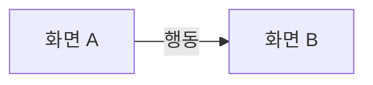

# <flow>

> 사용자가 무엇을 하려고 어떤 화면들을 거치는가.

## 참여 화면

| 순서 | 화면 | 사양                     |
| ---- | ---- | ------------------------ |
| 1    |      | [pages/…](../pages/….md) |

## 흐름

## 규칙 · 불변조건

- **R1** — WHEN <조건> THEN <결과>.

## 예외 케이스

| 케이스 | 동작 | 근거 |
| ------ | ---- | ---- |

## 근거

-
