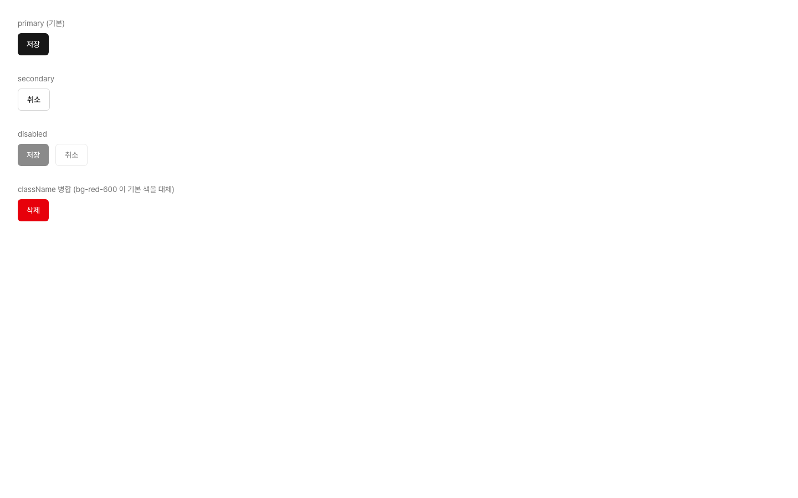

# Button

> 기본 버튼. import 경로: `@repo/ui/components/button`

## 화면



변형 · 상태 미리보기 = `apps/web/src/app/spec/components/button/page.tsx` (`/spec/components/button`, spec:shots 빌드에서만).

## Props

`ButtonHTMLAttributes<HTMLButtonElement>` 전부 + 아래.

| prop        | 타입                              | 기본값      | 설명                                                         |
| ----------- | --------------------------------- | ----------- | ------------------------------------------------------------ |
| `variant`   | `'primary' \| 'secondary'`        | `'primary'` | 색 변형                                                      |
| `type`      | `'button' \| 'submit' \| 'reset'` | `'button'`  | form 안에서 의도치 않은 submit 방지용 기본값                 |
| `className` | `string`                          | —           | 기본 클래스 뒤에 병합 (`tailwind-merge` — 충돌 시 뒤가 이김) |

## 변형 (variants)

| 값          | 모양                                                     |
| ----------- | -------------------------------------------------------- |
| `primary`   | 검정 배경(`neutral-900`) · 흰 글자 · hover `neutral-700` |
| `secondary` | 흰 배경 · 회색 테두리 · hover `neutral-100`              |

공통: 높이 40px(`h-10`) · 좌우 패딩 16px · `rounded-md` · `text-sm font-medium` · 색 전환 애니메이션.

## 상태

| 상태     | 표시                                                    |
| -------- | ------------------------------------------------------- |
| default  | 변형별 색                                               |
| hover    | 변형별 hover 색                                         |
| focus    | 키보드 포커스 시 `neutral-900` 2px outline (offset 2px) |
| disabled | 투명도 50% + 포인터 이벤트 없음                         |

## 사용법

```tsx
import { Button } from '@repo/ui/components/button';

// Server Component: 핸들러 없이 — form action 으로 제출
<form action={save}>
  <Button type="submit">저장</Button>
</form>;
```

```tsx
'use client'; // onClick 은 Client Component 안에서 정의해 넘긴다
import { Button } from '@repo/ui/components/button';

export function CopyButton({ text }: { text: string }) {
  return (
    <Button onClick={() => navigator.clipboard.writeText(text)}>복사</Button>
  );
}
```

- Button 에는 `'use client'` 가 없다. Server Component 에서 함수 prop(`onClick`)을 넘기면 정적 라우트는 `next build` 가, 동적 라우트는 요청 시 500 으로 실패한다 ("Event handlers cannot be passed to Client Component props"). 함수를 props 로 받는 client 컴포넌트를 Server Component 에서 쓰는 것도 같다 — 핸들러는 client 컴포넌트 안에서 만든다.
- 링크 이동에는 Button 을 `<Link>` 로 감싸지 않는다 (`<a>` 안 `<button>` = 중첩 인터랙티브 요소). `<Link>` 에 같은 클래스를 준다.

## 접근성

- native `<button>` — 키보드 포커스 · Enter / Space 동작 기본 제공.
- 아이콘만 넣을 때는 `aria-label` 필요 (컴포넌트가 강제하지 않음).

## 예외 케이스

| 케이스                                       | 동작                                                | 근거                                               |
| -------------------------------------------- | --------------------------------------------------- | -------------------------------------------------- |
| form 안에서 `type` 미지정                    | `button` — submit 되지 않음                         | `button.test.tsx › defaults to type="button"…`     |
| `disabled` + `onClick`                       | 클릭 이벤트 발생 안 함                              | native `disabled` + `disabled:pointer-events-none` |
| `className` 이 기본 색과 충돌 (`bg-red-500`) | 전달한 클래스가 이김 (기본 `bg-neutral-900` 제거)   | `cn` = `tailwind-merge` (`lib/cn.ts`)              |
| Server Component 에서 `onClick` 전달         | 정적 라우트 = 빌드 실패 · 동적 라우트 = 요청 시 500 | Next RSC 규칙 (위 사용법)                          |

## 사용처

- [Home](../pages/home.md)

## 근거

- `packages/ui/src/components/button.tsx` · `packages/ui/src/lib/cn.ts`
- 미리보기 `apps/web/src/app/spec/components/button/page.tsx`
- `apps/web/src/__tests__/ui/button.test.tsx`
