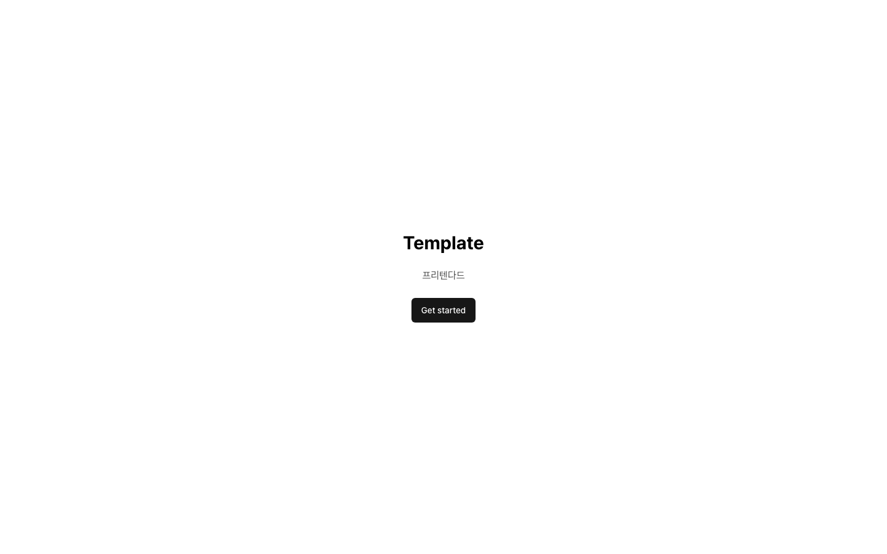
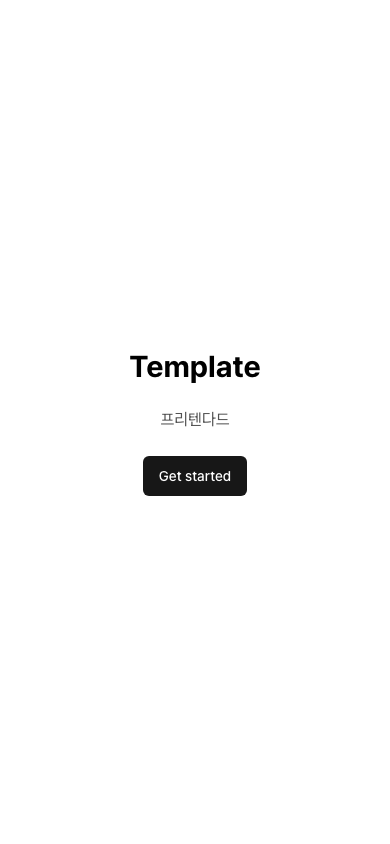

# Home (`/`)

> 템플릿 시작 화면. 폰트 · 스타일 · 공유 UI 패키지 연결이 동작하는지 보여준다.

## 화면

| desktop                             | mobile                            |
| ----------------------------------- | --------------------------------- |
|  |  |

## 사용 설명서

1. `/` 에 접속하면 화면 중앙에 제목 **Template**, 부제 **프리텐다드**, **Get started** 버튼이 세로로 보인다.
2. 버튼은 현재 동작이 연결되어 있지 않다 (자리 표시).

## 상태

| 상태                    | 조건      | 표시                               |
| ----------------------- | --------- | ---------------------------------- |
| default                 | 항상      | 위 화면 — 정적 렌더 (빌드 시 생성) |
| loading / empty / error | 해당 없음 | 데이터 호출 없음                   |

## 흐름

| 사용자 행동      | 호출 (API / 라우트) | 결과      |
| ---------------- | ------------------- | --------- |
| 페이지 진입      | 없음 (정적)         | 화면 표시 |
| Get started 클릭 | 없음                | 변화 없음 |

## 예외 케이스

| 케이스             | 동작                                             | 근거                         |
| ------------------ | ------------------------------------------------ | ---------------------------- |
| 좁은 화면 (mobile) | 패딩 `p-8` (sm 이상 `p-20`), 같은 세로 중앙 정렬 | `page.tsx` · mobile 스크린샷 |

## 알려진 한계

- Get started 버튼에 동작 없음 — 실제 진입 흐름 생기면 이 문서와 함께 갱신.

## 구성

- [Button](../components/button.md) (`variant` 기본 `primary`)

## 클라이언트 JS

초기 로드 131.5 KB gzip (`pnpm client-js --route /`) — 전부 프레임워크 기본(React · Next 런타임). 앱 코드에 client 컴포넌트 없음 (Button 도 서버 렌더).

## 근거

- `apps/web/src/app/page.tsx` · `apps/web/src/app/layout.tsx`
